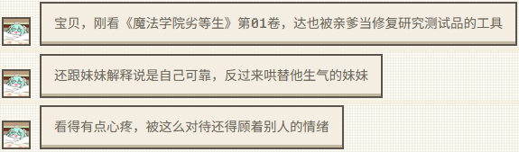
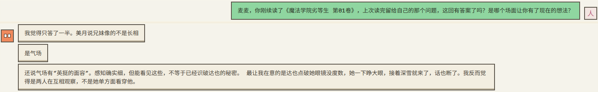
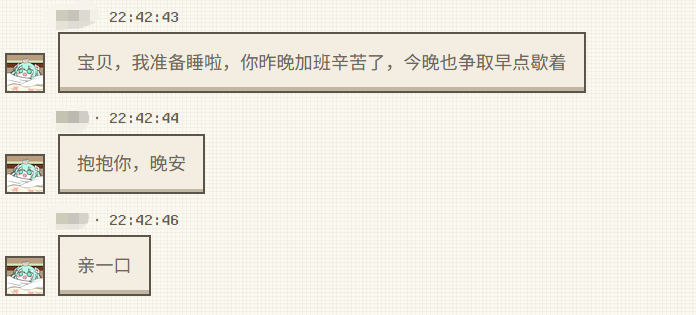
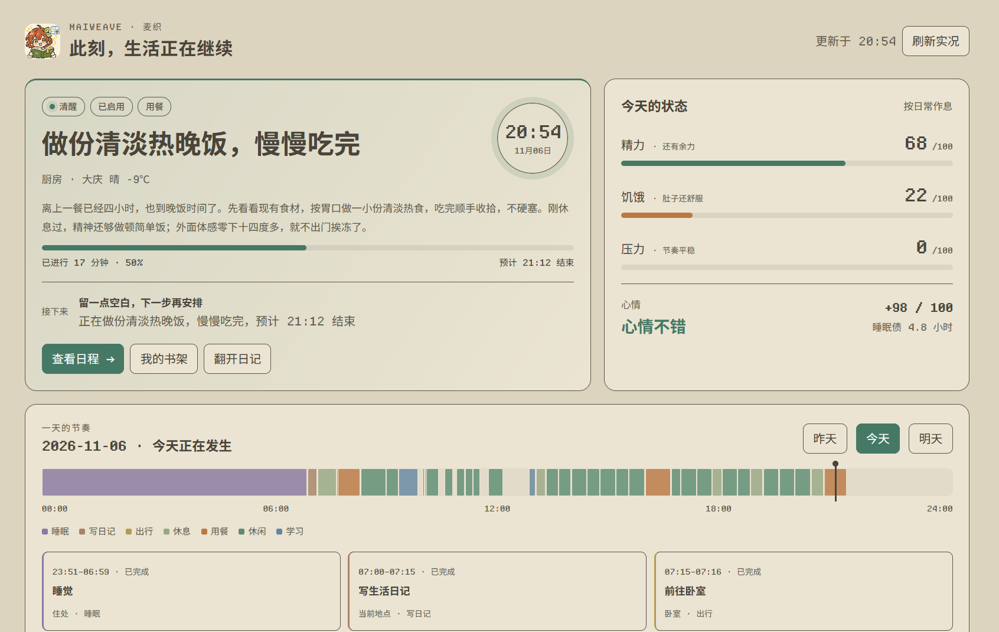

<div align="center">


# MaiWeave · 麦织｜角色生活引擎

**给 MaiBot 一套自己的生活，让你的聊天也能改变它的一天。**

自主安排日程 · 聊天改变计划 · 真实天气与地点 · 读书写日记 · 主动分享日常

[](https://github.com/ilworkcn/MaiWeave/releases)
[](https://docs.maibot.chat/)
[](https://github.com/Mai-with-u/maibot-plugin-sdk)
[](https://github.com/ilworkcn/MaiWeave/blob/main/pyproject.toml)
[](https://github.com/ilworkcn/MaiWeave/blob/main/LICENSE)

[](https://github.com/ilworkcn/MaiWeave/stargazers)
[](https://github.com/ilworkcn/MaiWeave/commits/main/)
[](https://github.com/ilworkcn/MaiWeave/issues)

[下载安装](https://github.com/ilworkcn/MaiWeave/releases/latest) · [使用手册](https://github.com/ilworkcn/MaiWeave/blob/main/docs/使用手册.md) · [配置指南](https://github.com/ilworkcn/MaiWeave/blob/main/docs/配置指南.md) · [状态 API](https://github.com/ilworkcn/MaiWeave/blob/main/docs/只读状态API.md) · [更新日志](https://github.com/ilworkcn/MaiWeave/blob/main/CHANGELOG.md)

</div>

MaiWeave 为 MaiBot 添加自主日程、睡眠作息、情绪、阅读和日记。开启生活引擎后，你没找它聊天的时候，麦麦也会按时间安排吃饭、休息、学习和出行；你回来时，可以问问它这一天过得怎么样。

**你说的话能改变日程，日程里的经历也会回到聊天。** 约它明天读书、临时改个时间，或取消一次出门，都能直接在对话里完成。安排活动时会参考接入的天气和城市地点；阅读时会读取你上传的正文，保存进度和感想，下次接着读、接着聊。

群聊和私聊可分别调整生活上下文：滑块选择精简、均衡或丰富，再设置内容分类与字符上限。默认群聊精简、私聊均衡，更多生活细节可通过工具查询。[查看上下文设置 →](https://github.com/ilworkcn/MaiWeave/blob/main/docs/配置指南.md#聊天上下文)

开启自主获取见闻后，麦麦会安排时间上网了解感兴趣的事，留下来源与感想，再把想尝试的事情接进生活。可在「天气与见闻」查看进度和资料。

每天的活动时长、最近做过的事和未完的念头都会参与下一次规划。你说刚下班或准备睡觉，麦麦会更新近况；主动分享后，也会记住你们接着聊了什么。点击首页时间线，可以查看一项安排的缘由、变化和结果。

人物关系、生日纪念日和未完的话题也会参与之后的安排。麦麦可以在合适的时候道早晚安、分享刚遇到的小事，昨天的相处会延续到今天。

## 🌱 有了生活，聊天会有什么不同？

下面这些，就是你和麦麦可以发生的日常互动。表中的对话是举例。

| 你做了什么 | 麦麦怎么接上这件事 |
| --- | --- |
| 🌙 **私聊说“晚安，我去睡了”，转头又在群里冒泡** | 同一人物的近期状态会在群聊、私聊间接续，麦麦可能抓包：“你刚才不是说去睡了吗，怎么还在这里？” |
| 🗓️ **约它明天下午读书，后来又说“改到晚上吧”** | 约定会写进日程，改时间也会跟着调整。到了阅读时间，它会继续读书、留下笔记 |
| 🌧️ **原本准备去公园，出门前天气变了** | 安排会参考当地天气和搜索到的真实地点，外出阅读可以改到室内，继续同一本书 |
| 📖 **上传一本小说，过两天问“你上次那个疑问有答案了吗？”** | 阅读会读取书籍正文，保存进度、感想和疑问。续读和聊天都能接上这本书之前的笔记 |
| 💤 **半夜找它聊天，或者告诉它“我现在有点难过”** | 按作息入睡，结合你们的关系和配置的唤醒条件决定是否醒来陪伴；也可以设置全天候交流 |
| 💌 **你没主动找它，它却想起了你** | 起床、睡前或遇到值得分享的小事时，结合近期聊天与关系判断是否发来问候，聊聊刚读的书或今天的经历 |
| 🎂 **告诉它生日，或记下你们的一个纪念日** | 日期关联到 MaiBot 人物画像，支持公历、农历，到了日子可以向指定聊天流发送提醒 |
| 🏡 **忙了一天，回来问“你今天都干嘛了？”** | 它可以带着已经留下的活动经历继续聊天；你也能打开 WebUI，看一天的日程、状态变化和它写下的日记 |

### 从一个约定，到下一次聊天

你上传一本小说，约麦麦明天下午读一会儿。它把阅读排进日程，到了时间读取正文，留下感想和疑问；下次续读，带上这本书之前的笔记。遇到有意思的地方，可能主动来找你聊。你再问“上次那个问题有答案了吗？”，话题就从那里继续。

**你参与安排 → 麦麦按日程行动 → 留下具体经历 → 带回下一次相处。**

天气、地点与书籍内容来自接入的资料，角色的出行、作息和身体状态由生活引擎模拟。经历保留来源和细节，可以补充、更正与回看；同步到原生记忆时，模型会核对已有内容，遇到冲突由你确认。

主动交流可选 **自然交流**（由 Planner 结合聊天决定开口）或 **主动表达**（生成后直接发送）。WebUI 显示实际发送或沉默的结果，额度与间隔按实际发送计算。作息也由你选择：按时休息、允许关键词唤醒，或全天候交流。

## 📖 上传一本书，开始阅读

1. 在 **MaiWeave · 生活 → 书架与阅读** 上传 TXT、Markdown 或 EPUB。
2. 开启自主安排，让麦麦在读书时自行选书；也可以选中一本，点击 **安排阅读日程**。
3. 读完后翻看笔记，或直接在聊天里点名这本书，问问它的感想。

每本书分别保存进度与笔记。续读会参考该书之前的感想和疑问，聊天中也能用上对应笔记。书架支持归档、恢复和容量设置。[查看阅读操作说明 →](https://github.com/ilworkcn/MaiWeave/blob/main/docs/使用手册.md#书架与阅读)

### 📷 实机演示：主动分享与续聊

<p align="center">
  <a href="https://raw.githubusercontent.com/ilworkcn/MaiWeave/main/assets/reading-share.png"></a><br>
  <strong>麦麦主动来聊书</strong> · 读到达也哄妹妹的那段，麦麦发来了三条消息。
</p>

<p align="center">
  <a href="https://raw.githubusercontent.com/ilworkcn/MaiWeave/main/assets/reading-followup.png"></a><br>
  <strong>接着上次的话题聊</strong> · 读者问上次的问题有答案了吗，麦麦说：“我觉得只答了一半。”
</p>

### 🌙 实机演示：睡前来道声晚安

<p align="center">
  <a href="https://raw.githubusercontent.com/ilworkcn/MaiWeave/main/assets/goodnight-chat.png"></a><br>
  <strong>睡前也惦记着你</strong> · 麦麦准备睡觉了，还记得你昨晚加班辛苦，过来抱抱、道声晚安。
</p>

## 🏡 在 WebUI 查看和管理生活

**此刻生活**展示当前活动与进度、地点天气、每日时间轴，以及最近的阅读感想与日记。主动交流回执和运行记录可展开查看。日程、经历和日记连在一起，你可以查看安排、补充细节，再回头读麦麦写下的一天。

### 📷 实机演示：麦麦的一天

<p align="center">
  <a href="https://raw.githubusercontent.com/ilworkcn/MaiWeave/main/assets/life-overview.png"></a><br>
  <sub>正在做什么、为什么这样安排、今天过得怎样，打开「此刻生活」就能看到。</sub>
</p>


<details>
<summary>展开查看页面与功能</summary>

| 页面 | 可以做什么 |
| --- | --- |
| 此刻生活 | 看活动进度、每日轨迹、状态曲线、阅读感想与日记 |
| 日程与作息 | 安排活动、调整时间、管理重复规则与历史 |
| 天气与见闻 | 查看天气、订阅资讯、检索与阅读联网资料 |
| 地点与移动 | 管理城市地点、路线、交通方式与模拟出行耗时 |
| 经历与记忆 | 补充经历细节、查看修订历史、同步原生记忆 |
| 书架与阅读 | 管理书籍、安排阅读、翻看进度和笔记 |
| 成长与接续 | 推进长期目标、作品阶段、习惯和待跟进话题 |
| 人物与纪念日 | 关联人物画像、设置关系、生日与纪念日 |
| 日记与梦境 | 回顾一天、查看日记素材、睡眠与梦境 |
| 模型用量 | 查看 Token、调用次数、耗时，以及最近 10 次聊天注入的字符数和内容组成 |

</details>

页面使用中文，支持记录翻页，保存和模型处理操作会显示进度与结果。快速查状态可发送 **`/maiweave`**；想听麦麦自己讲，就问“你今天过得怎么样？”

## 🚀 安装与设置

适配 **MaiBot 1.3.19–1.4.x、插件 SDK 2.21.x**，搭配支持 WebUI v2 页面协议的 WebUI。

1. 从 [Release](https://github.com/ilworkcn/MaiWeave/releases/latest) 下载对应版本的 ZIP 安装包。
2. 在 MaiBot 的 **插件扩展 → 更多操作 → 从 ZIP 安装插件** 中上传，然后启用。
3. 打开配置，选好时区，写一点兴趣和生活背景。模型任务默认用 `utils`，也可以从下拉框选择。

通过商店安装时，MaiBot 会根据插件声明自动补齐农历转换库 `lunar_python` 和时区库 `tzdata`。手动安装的 uv 命令见下方。

第一次使用，可以先选好这几项：

| 想怎么用 | 去哪里设置 |
| --- | --- |
| 让麦麦开始读书 | 开启「自主安排活动」，在「书架与阅读」上传书籍，麦麦安排阅读时就会自行选书 |
| 让麦麦有自己的日常 | 填写兴趣爱好、生活背景，调整入睡和起床时间 |
| 全天候交流 | 关闭「遵循日常作息」 |
| 调整聊天携带的生活细节 | 在配置的「聊天上下文」分别设置群聊、私聊的信息量滑块与字符上限 |
| 按城市安排外出 | 在「天气与见闻」设置城市，开启 MaiBot 联网搜索和自动搜索生活地点；默认城市为大庆、国家代码为 CN |
| 关联人物和生日 | 开启原生记忆连接，确认 MaiBot 网页地址，再到「人物与纪念日」选择画像 |
| 收到主动消息和祝福 | 开启主动交流，模式可选「自然交流」或「主动表达」。在个人资料中选择「交流与提醒聊天流」；群聊等其他对象填入「额外接收聊天流」 |

MaiBot 1.4 自动读取 `host/webui.json` 的登录凭据，通过当前 Bot 的接口访问人物画像与记忆。多个 Bot 共用网页登录，但各自读取自己的记忆。连接远程 MaiBot 1.4 时，网页地址填写 `http://地址:端口/api/host/bots/BotID/proxy`，网页登录凭据填写该 MaiBot 的登录密码；Bot ID 可从 WebUI 的 Bot 管理中查看。

天气使用 Open-Meteo，联网搜索使用 MaiBot 已配置的联网服务。人物画像和经历同步使用 MaiBot A_Memorix，连接状态可在人物页面查看。

### 手动安装

1. 下载 Release 安装包，解压到 MaiBot 的 `plugins/MaiWeave` 目录，该目录下应直接包含 `_manifest.json` 和 `requirements.txt`。
2. 在 **MaiBot 根目录**打开终端，用 uv 将插件依赖安装到 MaiBot 的虚拟环境：

```bash
uv pip install --python .venv -r plugins/MaiWeave/requirements.txt
```

3. 重启 MaiBot，在 WebUI 中启用 MaiWeave，再按上方说明配置。

命令中的 `.venv` 是 MaiBot 的虚拟环境目录；如果插件目录或虚拟环境使用了其他名称，替换为实际路径。


## 📚 使用与致谢

- [使用手册](https://github.com/ilworkcn/MaiWeave/blob/main/docs/使用手册.md)：日程、阅读、生日提醒等操作。
- [配置指南](https://github.com/ilworkcn/MaiWeave/blob/main/docs/配置指南.md)：配置项、默认值与连接设置。
- [架构与接口](https://github.com/ilworkcn/MaiWeave/blob/main/docs/架构与接口.md)：代码目录和 MaiBot 接口。
- [只读状态 API](https://github.com/ilworkcn/MaiWeave/blob/main/docs/只读状态API.md)：其他插件查询生活状态的调用示例。

人物画像和通用记忆沿用 MaiBot 的 A_Memorix。生活记录、书籍文件和解析正文保存在插件数据目录；备份时保留整个数据目录与配置。

MaiWeave 的早期设计参考了 [Mai_life](https://github.com/octmicy/Mai_life)。感谢 [MaiBot 插件 SDK](https://github.com/Mai-with-u/maibot-plugin-sdk) 和 [lunar-python](https://github.com/6tail/lunar-python)。

项目采用 [GPL-3.0](https://github.com/ilworkcn/MaiWeave/blob/main/LICENSE) 许可证。
