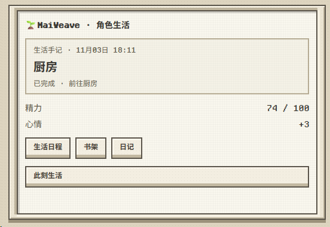

<div align="center">


# MaiWeave · 麦织

**聊完之后，麦麦的日子也在继续。**

[](https://github.com/ilworkcn/MaiWeave/releases)
[](https://docs.maibot.chat/)
[](LICENSE)
[](https://github.com/ilworkcn/MaiWeave/stargazers)
[](https://github.com/ilworkcn/MaiWeave/commits/main/)

[下载安装](https://github.com/ilworkcn/MaiWeave/releases/latest) · [使用手册](docs/使用手册.md) · [配置指南](docs/配置指南.md)

</div>

MaiWeave（麦织）让 MaiBot 有自己的日程。你可以约麦麦明晚看电影，也可以把一本书放上书架，等它读过几页，再来聊聊哪句话打动了它。

## 🌱 从首页看看麦麦在做什么

首页卡片显示插件加载时的生活快照，带有记录时间、地点、最近完成的活动、精力和心情。点 **此刻生活** 查看实时状态、最近一次自主规划和选择理由，展开「查看最近规划」可以回看十次安排。点 **生活日程** 看接下来的安排，点 **书架** 翻读书笔记，点 **日记** 回顾这一天。
<p align="center">
  <a href="assets/home-life-card.png"></a>
</p>

## 📖 给麦麦一本书，慢慢读，一起聊

**麦麦有自己的书架，也会留下读书笔记。** 把 TXT、Markdown 或 EPUB 放进书架。开启「自主安排活动」后，麦麦决定读书时，会自己从尚未读完、未归档的书里挑一本。模型会读取书里的正文，逐段整理读到了什么、喜欢哪句话、有什么感想。

每读完一段，麦麦会记下进度、原文摘句和自己的疑问。续读时，它会回看这本书最近的笔记。你问起上次没聊完的地方，它也能翻回来接着聊。

<p align="center">
  <a href="assets/reading-share.png"></a><br>
  <strong>麦麦主动来聊书</strong> · 读到达也哄妹妹的那段，麦麦发来了三条消息。
</p>

<p align="center">
  <a href="assets/reading-followup.png"></a><br>
  <strong>接着上次的话题聊</strong> · 读者问上次的问题有答案了吗，麦麦说：“我觉得只答了一半。”
</p>

**第一次使用，三步就够：**

1. 打开 **MaiWeave · 生活 → 书架与阅读**，上传一本 TXT、Markdown 或 EPUB。
2. 让麦麦按自己的日程选书阅读。想指定书和时间时，选中那本书，点 **安排阅读日程**。
3. 阅读完成后查看笔记，找麦麦聊聊刚读过的内容。

书架支持筛选、编辑、归档与恢复，笔记按书分页查看。归档会保留文件和进度，之后想读还能拿回来。每次阅读的正文篇幅和书架容量可在「日程与成长 → 书架与阅读」调整，阅读调用也会计入「模型用量」。[阅读操作说明](docs/使用手册.md#书架与阅读)

## 🌿 日子里还有这些事

| 功能 | 用起来是什么样 |
| --- | --- |
| 🗓️ 对话安排日程 | 直接聊天就能新增、改期、暂停、继续和取消活动，也能设置重复安排、跳过其中一次 |
| ☀️ 自主过日子 | 根据兴趣、生活背景、精力、饥饿和心情选择活动，遇到天气变化或临时约定时调整安排 |
| 🎯 把事情接着做 | 保存作品进度和下一步，把长期目标拆成阶段，空闲时继续推进；完成阅读笔记也会推进关联的阶段目标 |
| 🌱 养成日常习惯 | 从不同日期完成的活动中积累时间、地点和偏好，让常做的事慢慢融入日程 |
| 🏙️ 感知所在城市 | 查看当地天气，按活动搜索餐厅、咖啡馆、公园、商场等真实地点，也能阅读订阅资讯和联网资料 |
| 🚶 留出出行时间 | 为地点设置路线、交通方式和耗时，安排活动时把路上的时间一起算进去 |
| 🤝 记住身边的人 | 关联 MaiBot 原生人物画像，管理关系状态与亲密等级，让不同关系影响相处和日程调整 |
| 🎂 记住重要日子 | 保存生日和纪念日，支持公历、农历、倒计时，以及开启主动交流后的当日祝福 |
| 📔 写日记、做个梦 | 把写日记排进一天的安排，回顾经历、心情和作品进度；睡眠结束后可以生成梦境 |
| 💬 主动聊起近况 | 分享值得聊的经历、提醒共同安排、跟进之前惦记的事，可选自然交流或主动表达，也可开启随作息的自然早晚安 |
| 🌙 选择陪伴节奏 | 保留日常作息，设置聊天唤醒关键词；也可以关闭作息，全天候交流 |
| 📊 查看模型用量 | 按日期和功能查看插件的 Token、调用次数、耗时和调用记录 |

你们约好看电影，日程里就多了一项安排。临时改期可以直接开口，看完再告诉它片名和感想。你讲述的事、聊天中确认的事和麦麦自己模拟的经历会分别记录，也可以事后补充。

麦麦沿用 MaiBot 的人物画像来认人。熟悉的人可以约它挪一挪休闲活动，更亲近的人还可以在它睡着时叫醒它。修改生日或纪念日时，如果新日期和已有记录有出入，会请你确认。

## 💬 可以从这些话开始

| 想做什么 | 试着这样说 |
| --- | --- |
| 看看书架 | “书架上有哪些书？现在在读哪本？” |
| 安排读书 | “明晚八点，接着读当前这本书，读半小时。” |
| 聊聊读后感 | “今天读到了什么？哪句话让你印象最深？” |
| 约一次活动 | “明晚七点到九点，一起看电影吧。” |
| 临时改时间 | “明天有点事，电影改到后天八点。” |
| 安排固定活动 | “每周一、三、五晚上八点散步半小时，持续到月底。” |
| 跳过一次 | “下周三那次散步先跳过，其他日期照常。” |
| 补上经历细节 | “昨天那部电影看到一半停电了，后来没看完。” |
| 接着做昨天的事 | “昨天那本书读到哪里了？今天接着看吧。” |
| 定一个小目标 | “分五次读完这本书吧。” |
| 记下生日 | “我的生日是农历八月初三。” |
| 想有人陪一会儿 | “今天心情不好，陪陪我。” |

自然语言操作通过 MaiBot 的工具调用执行。想快速查看当前活动、精力、心情和聊天流 ID，可以发送 **`/maiweave`**；想听麦麦自己讲，就问一句“你现在在干什么？”

## 🖥️ 在 WebUI 里看看它的生活

打开 **MaiWeave · 生活**，就能查看近况、编辑记录、翻日记。配置和页面使用中文，人物、地点、历法等项目可以直接选择。

<details>
<summary>展开查看全部 10 个页面</summary>

| 页面 | 可以查看和操作的内容 |
| --- | --- |
| 此刻生活 | 当前活动、精力、饥饿、心情、生活趋势和运行状态 |
| 日程与作息 | 新增、编辑、取消单次安排，管理重复规则，查看冲突和调整结果 |
| 天气与见闻 | 天气预报、订阅资讯、联网资料和更新时间 |
| 地点与移动 | 搜索城市地点，编辑生活地点、路线、交通方式和耗时 |
| 经历与记忆 | 查看活动细节，补全或修订经历，查看原生记忆同步情况 |
| 书架与阅读 | 上传与管理书籍、选择当前读物、安排阅读，查看已读进度和分页笔记 |
| 成长与接续 | 长期目标、阶段进度、习惯、作品积累和待跟进的话题 |
| 人物与纪念日 | 选择原生人物画像，编辑生活资料、关系、生日和纪念日 |
| 日记与梦境 | 阅读日记、安排写作，查看睡眠记录和梦境 |
| 模型用量 | 按今天、近 7 天或近 30 天查看用量，按功能筛选调用记录 |

</details>

保存资料、搜索地点、生成阅读笔记等操作会显示处理进度和结果，方便知道当前进行到哪一步。

## 🚀 装起来

适配 **MaiBot 1.3.19–1.3.x、插件 SDK 2.21.x**，搭配支持 WebUI v2 页面协议的 WebUI。

1. 从 [Release](https://github.com/ilworkcn/MaiWeave/releases/latest) 下载对应版本的 ZIP 安装包。
2. 在 MaiBot 的 **插件扩展 → 更多操作 → 从 ZIP 安装插件** 中上传，然后启用。
3. 打开配置，选好时区，写一点兴趣和生活背景。模型任务默认用 `utils`，也可以从下拉框选择。

通过商店安装时，MaiBot 会根据插件声明自动补齐农历转换库 `lunar_python` 和时区库 `tzdata`。手动安装的 uv 命令见下方。

第一次使用，可以先选好这几项：

| 想怎么用 | 去哪里设置 |
| --- | --- |
| 让麦麦开始读书 | 开启「自主安排活动」，在「书架与阅读」上传书籍，麦麦安排阅读时就会自行选书 |
| 让麦麦有自己的日常 | 填写兴趣爱好、生活背景，调整入睡和起床时间 |
| 全天候交流 | 关闭「遵循日常作息」 |
| 按城市安排外出 | 在「天气与见闻」设置城市，开启 MaiBot 联网搜索和自动搜索生活地点；默认城市为大庆、国家代码为 CN |
| 关联人物和生日 | 开启原生记忆连接，确认 MaiBot 网页地址，再到「人物与纪念日」选择画像 |
| 收到主动消息和祝福 | 开启主动交流，模式可选「自然交流」或「主动表达」。在个人资料中选择「交流与提醒聊天流」；群聊等其他对象填入「额外接收聊天流」 |

天气使用 Open-Meteo，联网搜索使用 MaiBot 已配置的联网服务。人物画像和经历同步使用 MaiBot A_Memorix，连接状态可在人物页面查看。

### 手动安装

1. 下载 Release 安装包，解压到 MaiBot 的 `plugins/MaiWeave` 目录，该目录下应直接包含 `_manifest.json` 和 `requirements.txt`。
2. 在 **MaiBot 根目录**打开终端，用 uv 将插件依赖安装到 MaiBot 的虚拟环境：

```bash
uv pip install --python .venv -r plugins/MaiWeave/requirements.txt
```

3. 重启 MaiBot，在 WebUI 中启用 MaiWeave，再按上方说明配置。

命令中的 `.venv` 是 MaiBot 的虚拟环境目录；如果插件目录或虚拟环境使用了其他名称，替换为实际路径。


## 📖 想多了解一点

[使用手册](docs/使用手册.md)里有具体操作，[配置指南](docs/配置指南.md)里有默认值和连接方法。版本变化见[更新记录](CHANGELOG.md)，开发接口见[架构与接口](docs/架构与接口.md)。

人物画像和通用记忆沿用 MaiBot 的 A_Memorix。生活记录保存在插件数据目录的 `maiweave.sqlite3`，上传的书籍与解析正文也保存在插件数据目录中；备份时一起保留整个数据目录和配置。

感谢 [Mai_life](https://github.com/octmicy/Mai_life) 带来的灵感，以及 [MaiBot 插件 SDK](https://github.com/Mai-with-u/maibot-plugin-sdk) 和 [lunar-python](https://github.com/6tail/lunar-python)。项目使用 [GPL-3.0](LICENSE) 许可证。
