<div align="center">


# MaiWeave · 麦织｜角色生活引擎

**给 MaiBot 一套自己的生活，让你的聊天也能改变它的一天。**

随着相处积累熟悉、信任与亲近，麦麦会记住你的近况、生日和彼此的约定，结合你们的关系主动问候、关心后续。它也会安排作息、读书、出门，带着经历回来聊天，你的一句邀约也能改变它的日程。

自主安排日程 · 亲密关系与主动关心 · 聊天改变计划 · 真实天气与地点 · 读书写日记 · 日记发空间

[](https://github.com/ilworkcn/MaiWeave/releases)
[](https://docs.maibot.chat/)
[](https://github.com/Mai-with-u/maibot-plugin-sdk)
[](https://github.com/ilworkcn/MaiWeave/blob/main/pyproject.toml)
[](https://github.com/ilworkcn/MaiWeave/blob/main/LICENSE)

[](https://github.com/ilworkcn/MaiWeave/stargazers)
[](https://github.com/ilworkcn/MaiWeave/commits/main/)
[](https://github.com/ilworkcn/MaiWeave/issues)

[下载安装](https://github.com/ilworkcn/MaiWeave/releases/latest) · [使用手册](docs/使用手册.md) · [配置指南](docs/配置指南.md) · [状态 API](docs/只读状态API.md) · [更新日志](CHANGELOG.md)

</div>

<p align="center">
  <a href="#-有了生活聊天会有什么不同">日常互动</a> · <a href="#-麦麦的生活里有什么">功能一览</a> · <a href="#-看看麦麦的一天">界面与聊天</a> · <a href="#-安装与设置">安装设置</a>
</p>

## 🌱 有了生活，聊天会有什么不同？

下面这些，就是你和麦麦可以发生的日常互动。表中的对话是举例。

| 你做了什么 | 麦麦怎么接上这件事 |
| --- | --- |
| 🌙 **私聊说“晚安，我去睡了”，转头又在群里冒泡** | 同一人物的近况会在群聊、私聊间接续，麦麦可能抓包：“你刚才不是说去睡了吗，怎么还在这里？” |
| 🗓️ **“明天下午一起读书吧……还是改到晚上好了。”** | 约定写进日程，改时间也跟着调整。聊定的调休、请假，也会影响之后的安排。 |
| 📖 **“你上次读书时那个疑问，有答案了吗？”** | 麦麦带着之前的笔记继续读，聊起新章节时，也能接上上次的感想和疑问。 |
| 💌 **聊过你喜欢什么，后来也越来越熟悉** | 普通朋友可以聊共同兴趣和新发现；亲近以后，饭做得不错、听歌时的一点感受，也可能成为它想告诉你的小事。 |
| 💤 **半夜找它：“我有点难过，能陪陪我吗？”** | 按设置的唤醒条件醒来陪你，聊完互道晚安再接着睡。你也可以选择全天候交流。 |
| 🏡 **忙了一天回来：“今天过得怎么样？”** | 麦麦可以聊聊今天的活动、读过的书和留下的感想。打开 WebUI，还能翻看它的一天。 |

### 🍃 下一件事，接着今天的生活发生

麦麦会结合当下的精力、心情、天气、兴趣和最近的经历，选择接下来做什么。做饭时发现调料快用完了，下次出门可以顺路买；散步遇到一家想逛的店，会记着找时间再去；读书留下的疑问，也能成为下次翻开它的理由。累了就歇一会儿，有兴致的事可以多留些时间。

你们聊定的约定、正在推进的目标和慢慢养成的习惯，也会影响这些选择。已经排好的事项按日程进行，空闲时再想想接下来想做什么，让一天里的事情有前因，也有后续。

### 💞 越来越亲近，会有什么不同？

相处久了，你会更能参与麦麦的生活：

- **愿意为你腾出时间。** 普通关系优先约在空闲时；熟悉以后，可以调整休闲和休息活动；到了亲近，也可以为你的邀约调整自主安排的学习、工作和日记时间。
- **小事也想告诉你。** 普通、熟悉的朋友更适合聊共同兴趣和关心的进展；亲近以后，饭做得不错、读到一句喜欢的话，也可以成为来找你的理由。开启作息问候后，麦麦还会考虑向最近聊过的亲近对象道声早晚安。
- **困了，也能再陪你一会儿。** 到了亲密，可以进一步调整睡眠安排；临时醒来后的陪伴时间也会随亲密等级增加，互道晚安后再接着睡。

主动私聊还没等到回复，或是你说去睡了，却又在群里冒泡，麦麦可能在群里轻轻接一句。之后你在哪个聊天回应，她就在哪里接着聊；换了话题就聊新话题。

关系可以结合原生画像与互动逐渐积累，也可以在「人物与纪念日」手动设置。普通分享按你设置的时段、间隔和每日次数发送。如果麦麦答应「到了告诉你」，就算当天分享额度已用完，到站后也会在允许交流时回来报信。[查看亲密等级与日程说明 →](docs/使用手册.md#修改资料与亲密等级)

## 🧺 麦麦的生活里有什么？

| 主要功能 | 可以做什么 |
| --- | --- |
| 🗓️ **日程与作息** | 结合当前状态、天气和之前的经历选择后续活动；聊天可以新增、改期或取消安排，也能管理重复日程与睡眠作息。 |
| 🗺️ **生活地图** | 看麦麦现在在哪儿、下一站去哪里。点选两个地点，就能查看沿途各站、用时和车费。 |
| 💼 **工作与课表** | 按角色身份安排上班或上课。通勤、午休和下班都有各自的时间，工作里的进展和委屈也能带回聊天。 |
| 👛 **钱包与生活开销** | 领工钱、付车费、买菜、交房租。打开「此刻生活」就能看到存款、最近收支和冰箱里还剩几餐。 |
| 💞 **相处与主动交流** | 积累熟悉、信任与亲近，结合原生人物画像和聊天选择分享话题，问候早晚安、跟进约好的事。 |
| 📚 **书架与阅读** | 上传 TXT、Markdown、EPUB，读取正文，分别保存每本书的进度、感想和疑问。 |
| 🌦️ **天气、地点与出行** | 查询真实天气和城市地点，结合路线、交通方式与路程安排模拟出行。 |
| 🔎 **联网见闻** | 按兴趣检索和阅读资料，记下来源与感想，把想尝试的事放进后续生活。 |
| 🌱 **状态与成长** | 精力、饥饿和心情随活动变化；活动可以接着上次的进展展开，积累习惯、推进长期目标。 |
| 🎂 **生日与纪念日** | 关联 MaiBot 人物，配置公历或农历日期，向选定的聊天流发送祝福和提醒。 |
| 📷 **角色与图片** | 共用角色卡和参考图，追问时展示生活小事，主动分享与空间随笔也可以配图；在 WebUI 中调整画风、试画和预览。 |
| 📝 **日记、梦境与空间** | 留下日记和梦境，把一天的片段整理成随笔，预览后发布或自动发到 QQ 空间。 |
| 🧠 **经历与记忆** | 保存经历细节、补充事实、回看修订记录，并与 MaiBot 原生记忆衔接。 |
| 🏡 **WebUI 与状态 API** | 查看生活状态、管理日程和书架、统计模型用量；通过只读 API 获取状态与行为判断。 |

天气、地点和书籍正文来自接入的资料，角色的出行、作息与身体状态由生活引擎模拟。经历会保留来源，方便之后接着聊、补充和回看。

### 💼 工作与课表

在「角色设定」里可以写下麦麦的身份，比如初二学生、博士生或自由译者。留空时，麦麦会在首次运行时从人设读取身份并记住。打开「日程与作息」，就能调整哪天上课、在哪儿上班，也可以调班或请假。除了固定班次，她还可能从先前的经历里找到临时工作。

同一句“今天怎么样？”，赶着交稿和刚得到同事帮忙时，麦麦会有不同的事想说。手里的活没做完，下个班还能接着做；答应你“下班再讲”，忙完也能回来把那件事讲完。

### 👛 钱包与生活开销

坐公交上班会扣车费，做完有报酬的班次会领工钱。下班路过便利店，麦麦会看看冰箱里还有几餐，再决定要不要买菜。食材在买的时候付钱，做好的饭可以留到下一餐。

在「插件配置 → 日程与成长 → 经济设置」可以设起始存款、房租、每月杂费和交租日。快交租时，她会给账单和接下来一周的饭钱留些余地。手头紧时可以在私聊借钱，领了工钱按借款到账的先后还；借给她的人会在各自的私聊收到还款消息。

## 📷 看看麦麦的一天

### 🏡 生活面板 · 今天过得怎么样？

18:29，麦麦正从住处走去厨房，打算用冰箱里的食材做晚饭。右边能看到还剩几餐食材、今天领了多少工钱，地图下方是她从早到晚走过的行程。

<p align="center">
  <a href="https://raw.githubusercontent.com/ilworkcn/MaiWeave/main/assets/life-overview.png">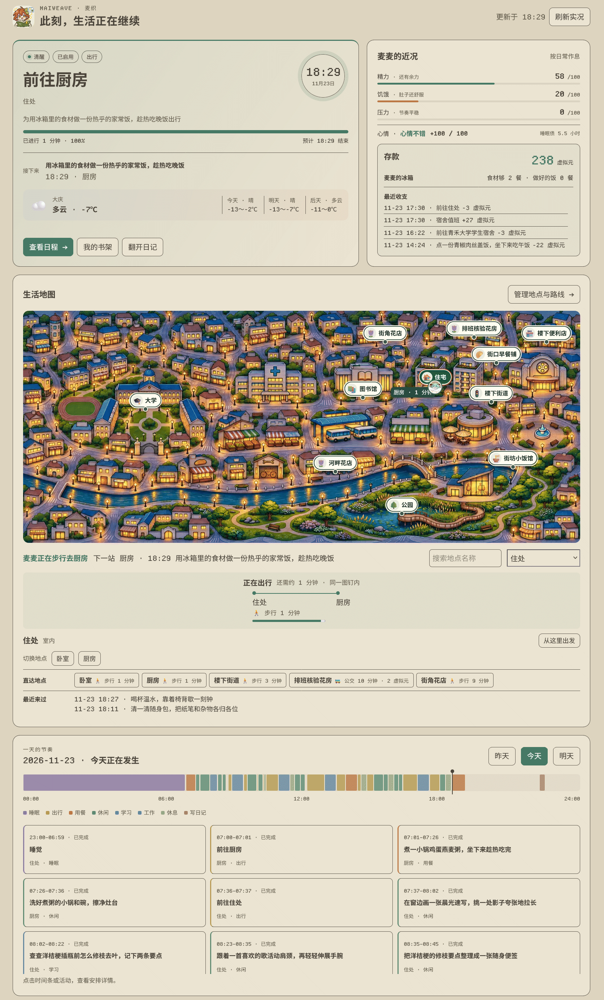</a>
</p>

### 🌇 生活地图 · 从天亮到熄灯

从楼下街道走到图书馆要 18 分钟。沿着同一条路，春天能看到河边的花，夏天树荫更浓，秋夜的街灯照着红叶，冬天能透过枝杈看清河岸。地图按麦麦的生活时区亮灯，深夜只留下路灯。

<p align="center">
  <a href="https://raw.githubusercontent.com/ilworkcn/MaiWeave/main/assets/map-demo/spring.webp">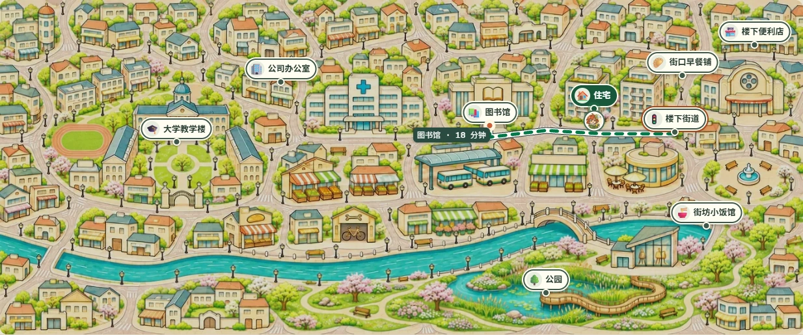</a><br>
  <sub>春日 · 河边开花</sub>
</p>

<p align="center">
  <a href="https://raw.githubusercontent.com/ilworkcn/MaiWeave/main/assets/map-demo/summer.webp">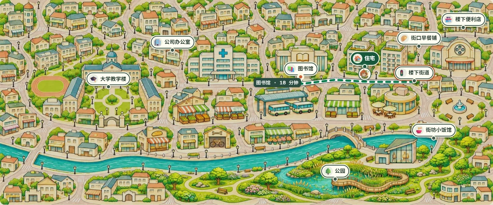</a><br>
  <sub>夏日 · 树荫沿岸</sub>
</p>

<p align="center">
  <a href="https://raw.githubusercontent.com/ilworkcn/MaiWeave/main/assets/map-demo/autumn.webp">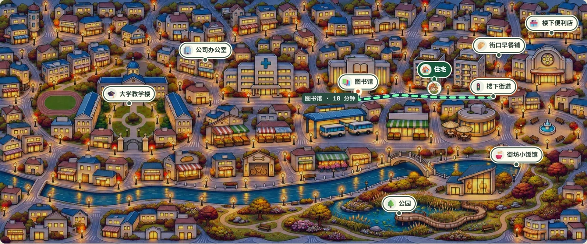</a><br>
  <sub>秋夜 · 街灯初亮</sub>
</p>

<p align="center">
  <a href="https://raw.githubusercontent.com/ilworkcn/MaiWeave/main/assets/map-demo/winter.webp">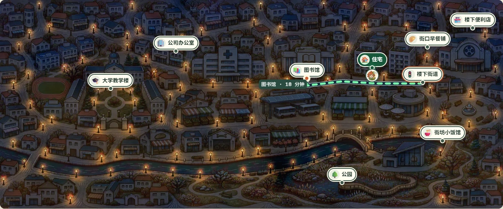</a><br>
  <sub>冬夜 · 河岸落叶</sub>
</p>

#### 🌧️ 下雨、落雪和冰雹

雨势渐大时，街面会映出灯光。小雪只薄薄落一点，大雪才盖住屋顶；遇到冰雹，湿路上能看到细小的冰粒。

下面截取同一段河岸。点图可以查看整张地图。

<div align="center">
<table>
  <tr>
    <td align="center"><a href="https://raw.githubusercontent.com/ilworkcn/MaiWeave/main/assets/map-demo/rain-light.webp"></a><br><sub>小雨</sub></td>
    <td align="center"><a href="https://raw.githubusercontent.com/ilworkcn/MaiWeave/main/assets/map-demo/snow-light.webp">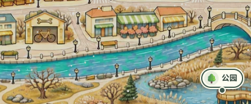</a><br><sub>小雪</sub></td>
  </tr>
  <tr>
    <td align="center"><a href="https://raw.githubusercontent.com/ilworkcn/MaiWeave/main/assets/map-demo/rain-medium.webp"></a><br><sub>中雨</sub></td>
    <td align="center"><a href="https://raw.githubusercontent.com/ilworkcn/MaiWeave/main/assets/map-demo/snow-medium.webp"></a><br><sub>中雪</sub></td>
  </tr>
  <tr>
    <td align="center"><a href="https://raw.githubusercontent.com/ilworkcn/MaiWeave/main/assets/map-demo/rain-heavy.webp">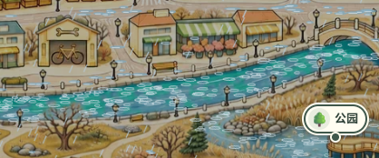</a><br><sub>大雨</sub></td>
    <td align="center"><a href="https://raw.githubusercontent.com/ilworkcn/MaiWeave/main/assets/map-demo/snow-heavy.webp"></a><br><sub>大雪</sub></td>
  </tr>
  <tr>
    <td align="center"><a href="https://raw.githubusercontent.com/ilworkcn/MaiWeave/main/assets/map-demo/hail.webp">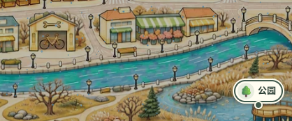</a><br><sub>冰雹</sub></td>
    <td align="center"><a href="https://raw.githubusercontent.com/ilworkcn/MaiWeave/main/assets/map-demo/thunder-hail.webp">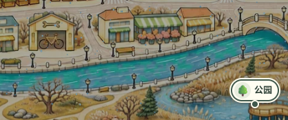</a><br><sub>雷暴伴冰雹</sub></td>
  </tr>
</table>
</div>

### 💬 下班再跟你讲

麦麦正在校对样书，你问她封底改了哪里。她约好七点四十左右来找你。19:39:55，她自己发来一句「刚收工啦，来跟你说一声」，接着讲了封底署名的事。

<p align="center">
  <a href="https://raw.githubusercontent.com/ilworkcn/MaiWeave/main/assets/after-work-chat.png"></a>
</p>

### 📸 图文分享 · 做好了，想给你看看

饭菜、手工作品，或路上看到的小景，都可以成为一条带图的分享。你也可以接着问：“是什么样的？给我看看。”

<p align="center">
  <a href="https://raw.githubusercontent.com/ilworkcn/MaiWeave/main/assets/life-image-chat.png"></a>
</p>

开启方式：在 **插件配置 → 模型设置** 配好图片生成服务，并开启 **图片用途 → 聊天追问发图与主动分享配图**。外貌、参考图和画风在 **此刻生活 → 角色与图片** 调整，保存后可以「试画一张」。出图尺寸可在模型设置中选择，默认横版 4:3，同一经历已有图片时继续复用。[查看图片使用说明 →](docs/使用手册.md#聊天里看看麦麦做了什么)

### 🧣 出门裹暖一点，回家轻松一点

穿着也跟着生活走。户外气温 -4.3℃，麦麦穿上羽绒服、围好围巾；回到温暖的厨房，换成米白色毛衣。右图使用左图作为人物参考，沿用外貌，按室内场景调整穿着。

<table>
  <tr>
    <th width="50%">🍂 公园散步</th>
    <th width="50%">🏡 厨房里的小日常</th>
  </tr>
  <tr>
    <td><a href="https://raw.githubusercontent.com/ilworkcn/MaiWeave/main/assets/life-outdoor-outfit.png"></a></td>
    <td><a href="https://raw.githubusercontent.com/ilworkcn/MaiWeave/main/assets/life-indoor-outfit.png"></a></td>
  </tr>
</table>

## 📖 上传一本书，开始阅读

1. 在 **MaiWeave · 生活 → 书架与阅读** 上传 TXT、Markdown 或 EPUB。
2. 开启自主安排，让麦麦在读书时自行选书；也可以选中一本，点击 **安排阅读日程**。
3. 读完后翻看笔记，或直接在聊天里点名这本书，问问它的感想。

每本书分别保存进度与笔记。续读会参考该书之前的感想和疑问，聊天中也能用上对应笔记。书架支持归档、恢复和容量设置。[查看阅读操作说明 →](docs/使用手册.md#书架与阅读)

<details>
<summary>调整自主阅读的时长和间隔</summary>

自主阅读默认每天最多 90 分钟，单次最多 40 分钟，两次之间留出 60 分钟做别的事。在「日程与成长 → 日常阅读」可以修改每日上限，-1 表示每日无上限，0 表示关闭自主阅读；单次时长和间隔在「高级设置 → 自主阅读节奏」调整；聊天和书架里手动约好的阅读照常执行。

</details>

<p align="center">
  <a href="https://raw.githubusercontent.com/ilworkcn/MaiWeave/main/assets/reading-share.png">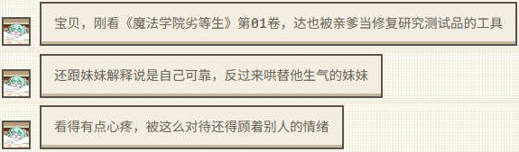</a><br>
  <strong>麦麦主动来聊书</strong> · 读到达也哄妹妹的那段，麦麦发来了三条消息。
</p>

<p align="center">
  <a href="https://raw.githubusercontent.com/ilworkcn/MaiWeave/main/assets/reading-followup.png">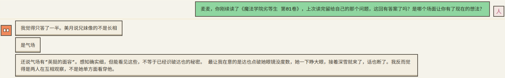</a><br>
  <strong>接着上次的话题聊</strong> · 读者问上次的问题有答案了吗，麦麦说：“我觉得只答了一半。”
</p>

## 🌙 睡前，也来道声晚安

开启主动交流和作息问候后，麦麦会结合你们的关系与近期聊天，在起床或睡前找个合适的时机来问候。

日常活动跟随你设定的入睡时间，睡前半小时再慢慢收尾，自动日记尽量提前写完。休息时仍可聊天，实际入睡后按作息设置保持安静。

<p align="center">
  <a href="https://raw.githubusercontent.com/ilworkcn/MaiWeave/main/assets/goodnight-chat.png">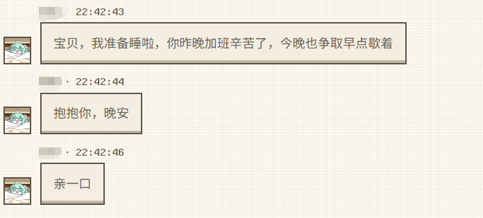</a><br>
  <strong>睡前也惦记着你</strong> · 麦麦准备睡觉了，还记得你昨晚加班辛苦，过来抱抱、道声晚安。
</p>

## 📝 把一天的日常，写进 QQ 空间

麦麦写完日记，可以从当天的片段中整理一篇随笔，发到自己的 QQ 空间。日记和空间文案分别保存，你可以先看看，再修改、发布。

想给随笔配图，在 **模型设置 → 图片用途** 开启 **空间随笔自动配图**。空间与聊天共用角色卡和参考图，画风可以分别设置；在随笔详情中还能修改画面描述、重画和预览。

在 **日记与梦境 → 日记详情 → 日记发空间** 中生成和编辑文案。发布默认关闭，可选择手动发布，或随当天写日记日程完成后自动发布，每天一篇；可见范围支持好友、所有人和仅自己。

需要 **MaiBot OneBot 适配器与已登录的 SnowLuma 或 NapCat**，沿用当前 QQ 登录。NapCat 通过适配器获取空间 Cookie，再上传配图、发布随笔。 [查看空间发布步骤 →](docs/使用手册.md#日记发空间)

## 🏡 打开 WebUI，翻翻它的生活

「此刻生活」可以看当前活动、地点天气、一天的日程和状态变化，也能查看主动消息发给了谁、发了什么、最近为什么发送或等待。其他页面用于安排活动、管理书籍和整理生活记录。

<details>
<summary>各个页面在哪里、能做什么</summary>

| 页面 | 可以做什么 |
| --- | --- |
| 此刻生活 | 看城市地图与麦麦所在的房间、活动进度、每日轨迹、状态曲线、存款与最近收支、阅读感想与日记 |
| 日程与作息 | 安排活动、调整时间、管理重复规则与历史 |
| 天气与见闻 | 查看天气、订阅资讯、检索与阅读联网资料 |
| 地点与移动 | 管理地点、上班地点、单程车费 |
| 经历与记忆 | 补充经历细节、查看修订历史、同步原生记忆 |
| 书架与阅读 | 管理书籍、安排阅读、翻看进度和笔记 |
| 成长与接续 | 推进长期目标、作品阶段、习惯和待跟进话题 |
| 人物与纪念日 | 关联人物画像、设置关系、生日与纪念日 |
| 日记与梦境 | 回顾一天、查看日记素材、睡眠与梦境；生成和发布空间随笔 |
| 角色与图片 | 编辑外貌和画风、管理参考图，试画自拍或物件近景 |
| 模型用量 | 查看 Token、调用次数、耗时，以及最近 10 次聊天注入的字符数和内容组成 |

</details>

页面使用中文，支持记录翻页，保存和模型处理操作会显示进度与结果。快速查状态可发送 **`/maiweave`**；想听麦麦自己讲，就问“你今天过得怎么样？”

<details>
<summary>精力会影响什么？</summary>

麦麦可以是初二学生、在读博士，也可以当老师或在家审稿。插件设置里能直接写她的身份，留空就从人设读取。课程、组会和工作班次都可以在「日程与作息」里改。普通工作每小时消耗 5 点精力；搬货更费力，赶稿更费神。忙时她可能只腾得出空回一句，受了委屈，下班后也可能想找熟悉的人聊聊。

睡眠每小时恢复 10 点精力，休息恢复 5 点。连续晚睡会留下睡眠债。精力降到 25 或以下时，麦麦会优先休息，普通主动分享等恢复后再聊。

</details>

## 🚀 安装与设置

本页展示 develop 分支的生活地图、排班、钱包和冰箱。下载稳定版时，可在 [Release](https://github.com/ilworkcn/MaiWeave/releases/latest) 查看该版本的功能。

适配 **MaiBot 1.3.19–1.4.x、插件 SDK 2.21–2.23**，搭配支持 WebUI v2 页面协议的 WebUI。

1. 从 [Release](https://github.com/ilworkcn/MaiWeave/releases/latest) 下载对应版本的 ZIP 安装包。
2. 在 MaiBot 的 **插件扩展 → 更多操作 → 从 ZIP 安装插件** 中上传，然后启用。
3. 打开配置，选好时区，写一点兴趣和生活背景。模型任务默认用 `utils`，也可以从下拉框选择。

商店安装会自动安装所需依赖。手动安装方式和依赖版本见下方。

第一次使用，可以先选好这几项：

| 想怎么用 | 去哪里设置 |
| --- | --- |
| 让麦麦开始读书 | 开启「自主安排活动」，在「书架与阅读」上传书籍，麦麦安排阅读时就会自行选书 |
| 让麦麦有自己的日常 | 填写兴趣爱好、生活背景，调整入睡和起床时间 |
| 全天候交流 | 关闭「遵循日常作息」 |
| 调整聊天中的生活细节 | 在「聊天上下文」为群聊、私聊分别选择精简、均衡或丰富，并调整内容分类与字符上限；当前活动、经历和接续按话题整理，同一内容合并展示 |
| 按城市安排外出 | 设置天气城市，开启 MaiBot 联网搜索和自动搜索生活地点 |
| 记住你和重要的日子 | 连接 MaiBot 记忆，在「人物与纪念日」选择人物画像，填写生日、纪念日和提醒聊天流 |
| 展示生活图片 | 配好图片生成服务，开启聊天图片，在「角色与图片」设置外貌、参考图和画风 |
| 收到主动消息和祝福 | 开启主动交流，在个人资料中选择「交流与提醒聊天流」 |

**接上麦麦已有的记忆。** 在 MaiBot 人物画像中选中你，补上生活备注、生日和纪念日，让之后的相处接着这些记忆继续。同机运行的 MaiBot 1.4 可自动连接，状态在人物页面查看。[记忆连接设置 →](docs/配置指南.md)

模型任务可在插件配置的「模型设置」中按功能选择；更新频率、容量和数据保留集中在「高级设置」。详见[配置指南](docs/配置指南.md)。

天气可选择 Open-Meteo 或心知天气，联网见闻和地点搜索使用 MaiBot 已配置的联网服务。主动交流方式、发送频率和聊天细节等选项，见[配置指南](docs/配置指南.md)。

<details>
<summary>手动安装与依赖版本</summary>

农历纪念日使用 `lunar_python>=1.4.8`，生活时区使用 `tzdata>=2024.1`，图片处理使用 `Pillow>=10.0`。插件已适配 MaiBot SDK 2.21、2.22 和 2.23 系列。

1. 下载 Release 安装包，解压到 MaiBot 的 `plugins/MaiWeave` 目录，该目录下应直接包含 `_manifest.json` 和 `requirements.txt`。
2. 在 **MaiBot 根目录**打开终端，用 uv 将插件依赖安装到 MaiBot 的虚拟环境：

```bash
uv pip install --python .venv -r plugins/MaiWeave/requirements.txt
```

3. 重启 MaiBot，在 WebUI 中启用 MaiWeave，再按上方说明配置。

命令中的 `.venv` 是 MaiBot 的虚拟环境目录；如果插件目录或虚拟环境使用了其他名称，替换为实际路径。

</details>

## 📚 想了解更多

设置和操作步骤都放在 [文档目录](docs/README.md) 中：

- [使用手册](docs/使用手册.md)：日程、阅读、生日提醒等操作。
- [配置指南](docs/配置指南.md)：配置项、默认值与连接设置。
- [功能与数据说明](docs/架构与接口.md)：日程、经历、聊天与记忆如何配合。
- [只读状态 API](docs/只读状态API.md)：两个只读接口的调用方式、完整字段与场景示例。

运行明细每天按保留天数和条数整理，可在「经历与记忆」预览清理；日记、空间发布记录和阅读笔记长期保存。

人物画像和通用记忆沿用 MaiBot 的 A_Memorix。备份时，请保留插件的整个数据目录与配置，其中包含生活记录、书籍文件和解析正文。

## 💚 感谢与许可

MaiWeave 早期版本的部分设计参考了 [Mai_life](https://github.com/octmicy/Mai_life)。感谢 [MaiBot 插件 SDK](https://github.com/Mai-with-u/maibot-plugin-sdk) 和 [lunar-python](https://github.com/6tail/lunar-python)。

感谢每一位为 MaiWeave 提出建议、反馈问题和参与测试的朋友。你们分享的使用体验、发现的小问题和想到的新点子，让麦麦的日常一点点变得更丰富。

项目采用 [GPL-3.0](https://github.com/ilworkcn/MaiWeave/blob/main/LICENSE) 许可证。
